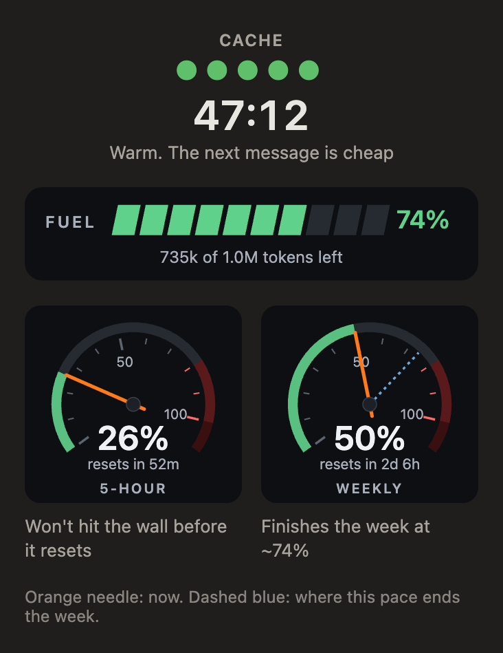

# Dash

**A car dash for Claude Code: how much context you have left, where your limits are headed, and how long until the cache goes cold.**

Dash is a mod for Claude Code. It puts one line above the prompt and a panel of gauges on the side, and it works in the desktop app and in the terminal.

## Install

    claude plugin install dash --marketplace Steady-Matter/dash

Start a new session and it's on. Built and tested on Claude Code 2.1.304. The limit dials only fill in on a Claude subscription, because that's the only place Claude Code reports limits.

## The line above the prompt

It's always there, and it's one row:

    FUEL ▰▰▰▰▰▰▱▱ 74% │ 5h 26% clear · resets in 52m │ wk 50% → 74% │ ● 47:12

- **Fuel** is the context you have left before Claude Code compacts the conversation. If you set an auto-compact point (`autoCompactWindow` in your settings), the tank ends there; if not, it's the model's full window. It starts at 100% and counts down, so it goes from green to amber to red as the conversation fills up.
- **5h** is your 5-hour limit, and next to it is whether the pace so far gets you to the reset or runs into the wall first ("wall in 24m").
- **wk** is your weekly limit, and the number after the arrow is where you finish the week if you keep going at the pace so far.
- **●** is the prompt cache. Every reply keeps it warm for a while (an hour or five minutes, depending on your setup), and Dash counts that down.

The line changes when something needs you. In the cache's last two minutes it turns into a warning that tells you how long you have to send before the next message re-reads the whole conversation, with the token count. At 20% fuel or less it turns into a pit call with a Handoff button, which puts `/handoff` in your prompt and sends nothing. That's for people who keep a handoff command. If you don't have one, `/compact` or a fresh session does the same job.

## The panel

It opens by itself in the desktop app. In the terminal, type `/dash`.

- Five cache lights that go out as the time runs down, with a big countdown under them.
- The fuel bar, with the tokens you have left before auto-compact.
- A dial each for the 5-hour and weekly limits. The orange needle is where you are now, and on the weekly dial the dashed blue needle is where this pace ends the week.
- At a pit call, a red card with the same Handoff button.

## How the pace works

Dash takes how much of the window you've used and how long the window has been running, and carries that rate out to the reset. It stays blank for the first twentieth of a window (about 15 minutes of the 5-hour, about 8 hours of the week), because a few minutes of use doesn't say much about the rest. It's a straight-line guess, so a burst of heavy work moves it.

## Commands

| Type | Does |
| --- | --- |
| `/dash` | Open the panel. |
| `/dash close` | Close it. |

## What it touches

Dash only reads. It reads the usage numbers Claude Code already reports (context, limits and the auto-compact point) and the cache details on each reply. It sends nothing anywhere and changes no settings, and the only thing it ever writes is the text the Handoff button puts in your prompt.

## Credit

MIT licensed. Made by [Steady Matter](https://github.com/Steady-Matter).
